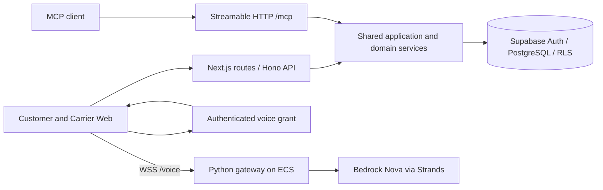

# Architecture

The application root is `cargomesh/`: Next.js 15, React 19 and TypeScript. REST runs on Hono; Supabase supplies authentication, PostgreSQL and row-level security. MCP uses `@modelcontextprotocol/sdk` 1.30.0. Python/Strands connects Web audio to Bedrock Nova.

The gateway receives a bounded signed context, not database credentials. It has no business mutation tools. Voice transcripts return to the application, where structured validation, identity and confirmation control persistence.

## Source map

| Path | Responsibility |
|---|---|
| `cargomesh/src/app/` | Pages, API entry points, OAuth metadata and MCP endpoint |
| `cargomesh/src/features/` | Customer, carrier, conversation, maps and visual components |
| `cargomesh/src/shared/schemas/v2/` | Zod DTOs and shared contracts |
| `cargomesh/src/server/hono/` | REST routing and middleware |
| `cargomesh/src/server/modules/` | Domain/application services and repositories |
| `cargomesh/src/server/mcp/` | MCP registration, transport, principal and OAuth checks |
| `cargomesh/src/server/conversation/` | Interpretation, scoped voice context and carrier briefing |
| `cargomesh/voice-pilot/` | Web voice gateway and standalone comparison pilots |
| `supabase-v2/` | Active V2 migration chain, manifest and local gate |
| `supabase/scenarios/v2-*/` | Explicit synthetic data, verification and cleanup |

Business writes use authenticated actor scope, RLS, canonical idempotency fingerprints and expected versions. Server-only credentials are not a substitute for a user's organization/carrier authorization. Browser demo transports do not forward fixture requests into production services.

Vercel hosts the Web application. ECS/ECR/ALB, Secrets Manager and the task role host/authenticate the voice gateway; Bedrock performs model inference. Kiro Crew is a development tool. Alexa+ is a separate prospective MCP client: successful Nova audio does not establish an Alexa account link or Echo session.
